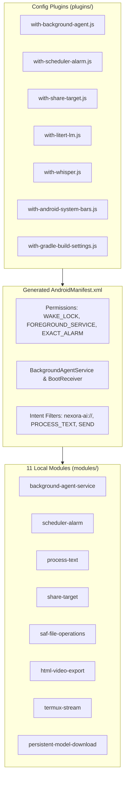

# Android Native Modules & Permissions Audit — NEXORA AI

## 1. Native Architecture Overview

NEXORA AI integrates 11 custom Android native modules written in Kotlin and registered via Expo Autolinking, plus 8 custom Expo config plugins that inject required manifest permissions, service declarations, intent filters, and native compiler configurations during `expo prebuild`.

---

## 2. Local Native Modules Deep Dive

### 1. `background-agent-service`
- **Location**: `modules/background-agent-service/android/`
- **Purpose**: Runs a foreground service (`BackgroundAgentService`) with `PARTIAL_WAKE_LOCK` and a persistent ongoing notification so the AI agent can complete long tasks while the device screen is off.
- **Battery Optimization**: Implements helper methods `requestBatteryOptimizationExemption()` and `isIgnoringBatteryOptimizations()` via Android's `PowerManager`.

### 2. `scheduler-alarm`
- **Location**: `modules/scheduler-alarm/android/`
- **Purpose**: Schedules exact alarm triggers using Android `AlarmManager`.
- **Boot Persistence**: Registers a `BootReceiver` for `Intent.ACTION_BOOT_COMPLETED` to reschedule active recurring cron tasks when the phone reboots.

### 3. `process-text`
- **Location**: `modules/process-text/android/`
- **Purpose**: Integrates with Android's system text selection context menu.
- **Deep Link**: Fires `nexora-ai:///settings/prompts?capture=1` to import highlighted text from any third-party app directly into NEXORA AI.

### 4. `share-target`
- **Location**: `modules/share-target/android/`
- **Purpose**: Registers an `ACTION_SEND` intent filter in `AndroidManifest.xml` accepting text, images, and files shared from other apps.

### 5. `saf-file-operations`
- **Location**: `modules/saf-file-operations/android/`
- **Purpose**: Native wrapper for Android's Storage Access Framework (`DocumentsContract`), enabling folder tree traversal, file reads, and writing to user-selected device storage without requiring dangerous broad file permissions.

### 6. `html-video-export`
- **Location**: `modules/html-video-export/android/`
- **Purpose**: Uses an invisible native Android WebView with hardware-accelerated offscreen canvas capturing to render HTML/Three.js frames directly into an H.264 MP4 container.

### 7. `persistent-model-download`
- **Location**: `modules/persistent-model-download/android/`
- **Purpose**: Large file downloader with chunked resumption, progress callbacks, and post-download SHA-256 checksum verification for on-device LiteRT models and Whisper weights.

### 8. `termux-stream`
- **Location**: `modules/termux-stream/android/`
- **Purpose**: Binds to the Termux background service to pipe stdio, execute shell commands, and stream live stdout/stderr into the in-app terminal console.

### 9. `local-tts`
- **Location**: `modules/local-tts/android/`
- **Purpose**: Native interface to Android `android.speech.tts.TextToSpeech` for offline spoken responses.

### 10. `bridge-network`
- **Location**: `modules/bridge-network/android/`
- **Purpose**: Queries active WiFi and network interface IPv4 addresses for desktop bridge pairing.

### 11. `quote-selection`
- **Location**: `modules/quote-selection/android/`
- **Purpose**: Native text selection and quote action handling in chat bubbles.

---

## 3. Permissions Inventory & Audit

Configured in [app.json](file:///storage/emulated/0/arya1/app.json#L30):

| Permission | Android API Level | Justification / Role |
| :--- | :--- | :--- |
| `CAMERA` | All | Scanning ACP host bridge pairing QR codes |
| `WAKE_LOCK` | All | Keeping CPU active during background agent runs |
| `FOREGROUND_SERVICE` | 28+ | Background agent service execution |
| `FOREGROUND_SERVICE_DATA_SYNC` | 34+ | Android 14 requirement for data processing service |
| `FOREGROUND_SERVICE_CONNECTED_DEVICE` | 34+ | Android 14 requirement for local bridge sockets |
| `ACCESS_WIFI_STATE` | All | Resolving local LAN IP for desktop pairing |
| `CHANGE_WIFI_STATE` | All | Network state management |
| `REQUEST_IGNORE_BATTERY_OPTIMIZATIONS` | 23+ | Prompting exemption so OS does not kill background tasks |
| `POST_NOTIFICATIONS` | 33+ | Android 13+ permission for task and approval alerts |
| `SCHEDULE_EXACT_ALARM` | 31+ | Android 12+ permission for exact cron scheduling |
| `USE_EXACT_ALARM` | 33+ | Fallback exact alarm permission |
| `RECEIVE_BOOT_COMPLETED` | All | Rescheduling alarms after phone reboot |
| `REQUEST_INSTALL_PACKAGES` | 26+ | Enabling in-app APK update installation |

---

## 4. Native Build Properties

In `app.json` under `expo-build-properties`:
- **`minSdkVersion`**: `26` (Android 8.0 Oreo - covers 98%+ of active Android devices).
- **`targetSdkVersion`**: `35` (Android 15).
- **`usesCleartextTraffic`**: `true` (Allows local LAN HTTP communication with host bridges on `192.168.x.x`).
- **Architectures**: `arm64-v8a` targeted for performance and LiteRT-LM hardware optimization.
