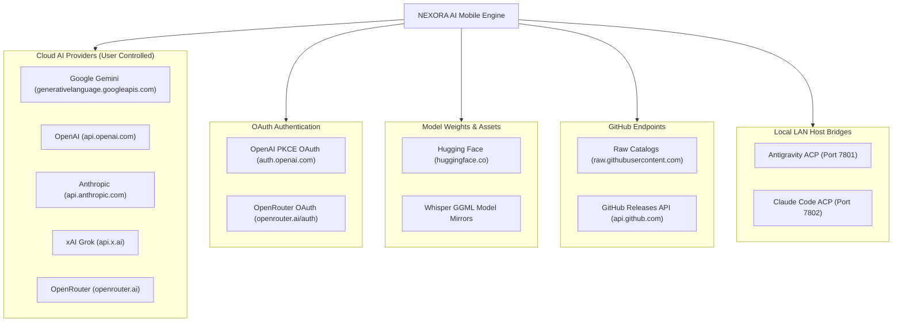

# External APIs & Network Services Audit — NEXORA AI

## 1. Complete External Service Inventory

---

## 2. Service-by-Service Specifications

| Service / Endpoint | Protocol | Purpose | Mandatory? | Fallback / Offline Behavior |
| :--- | :--- | :--- | :--- | :--- |
| **Google Gemini API** | HTTPS REST / SSE | Gemini 1.5/2.0 text, vision, and tool calling | Optional | Returns network error; other providers unaffected |
| **OpenAI API** | HTTPS REST / SSE | GPT-4o, o1, o3, DALL-E 3 image generation | Optional | Returns network error |
| **Anthropic Claude API**| HTTPS REST / SSE | Claude 3.5 Sonnet / Haiku / Opus execution | Optional | Returns network error |
| **xAI Grok API** | HTTPS REST / SSE | Grok 2 vision & reasoning execution | Optional | Returns network error |
| **OpenRouter API** | HTTPS REST / SSE | Multi-model routing & fallback | Optional | Returns network error |
| **Ollama Local Engine**| HTTP REST | Local home network LLM execution | Optional | Fails if host IP is unreachable |
| **Hugging Face** | HTTPS Chunked | Download LiteRT `.litertlm` and Whisper models | Optional | Fails download; does not affect installed models |
| **OpenAI OAuth** | HTTPS PKCE | ChatGPT Plus/Team subscription login | Optional | User can use direct API key instead |
| **OpenRouter OAuth** | HTTPS PKCE | OpenRouter token acquisition | Optional | User can use direct API key instead |
| **GitHub Raw Catalogs** | HTTPS JSON | Tips, prompts, MCP, models, skills catalogs | Optional | **Graceful fallback to local bundled `catalog/*.json`** |
| **GitHub Releases API** | HTTPS REST | In-app notification of new APK releases | Optional | Checks skip silently if network fails; app runs normally |
| **Host ACP Bridges** | HTTP / SSE (LAN) | Real-time desktop coding agent interaction | Optional | Bridge UI shows connection timeout hint |
| **Expo EAS Services** | HTTPS REST | OTA update downloads & remote builds | Decoupled | App runs fully offline without EAS project |

---

## 3. Decoupling Original Developer Endpoints

The audit reveals zero private backend servers. Decoupling requires only updating public GitHub URLs:

1. **Releases API Endpoint**:
   - *Original*: `https://api.github.com/repos/TecnicalBot/mobile-agent/releases`
   - *Target*: `https://api.github.com/repos/stylesheet48-max/nexora-ai/releases`
   - *File*: [src/modules/updates/github-release.ts](file:///storage/emulated/0/arya1/src/modules/updates/github-release.ts#L5)
2. **Catalog Base URL**:
   - *Original*: `https://raw.githubusercontent.com/tecnicalbot/mobile-agent/refs/heads/main/catalog/...`
   - *Target*: `https://raw.githubusercontent.com/stylesheet48-max/nexora-ai/refs/heads/main/catalog/...`
   - *Files*: `src/modules/chat/composer-tip.ts`, `src/modules/chat/starter-prompts.ts`, `src/modules/mcp/catalog.ts`, `src/modules/on-device/catalog.ts`, `src/modules/plugins/catalog.ts`, `src/modules/providers/codex-models-catalog.ts`, `src/modules/skills/catalog.ts`, `src/modules/voice/catalog.ts`.
3. **Bridge Installer URL**:
   - *Original*: `https://raw.githubusercontent.com/tecnicalbot/mobile-agent/main/tools/install.sh`
   - *Target*: `https://raw.githubusercontent.com/stylesheet48-max/nexora-ai/main/tools/install.sh`
   - *File*: `src/components/settings/acp-connection-form.tsx:611`, `tools/install.sh:4`
