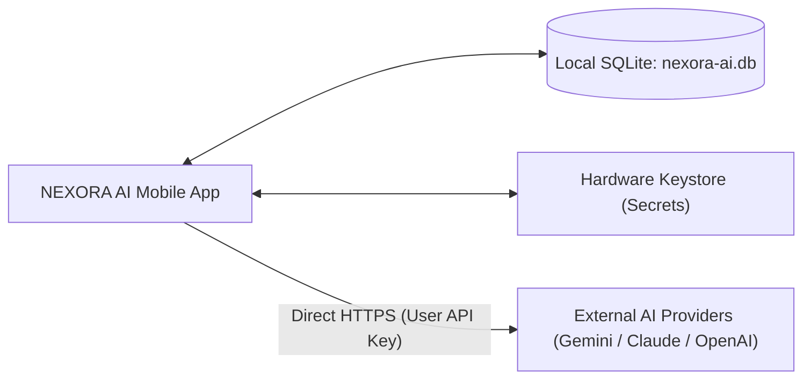
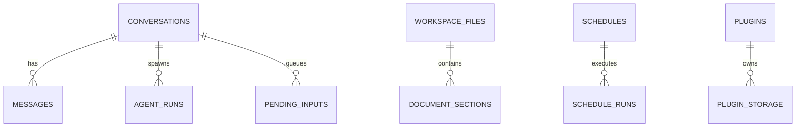

# Backend & Database Architecture Audit — NEXORA AI

## 1. Backend Architecture: 100% Serverless & Local-First

The audit confirms that **NEXORA AI operates without any proprietary backend server**:
- **No Cloud Backend**: There is no Node.js, Python, PHP, Ruby, or Go backend hosted on AWS, GCP, Vercel, or Heroku.
- **Client-Side Autonomy**: All agent orchestration, prompt assembly, context compression, tool dispatch, and SQLite persistence execute locally within the mobile JavaScript runtime (Hermes) and Android native modules.
- **Direct API Communication**: Cloud AI requests (Gemini, OpenAI, Anthropic, xAI) originate directly from the mobile client over TLS 1.3 HTTPS using credentials stored securely in the device hardware Keystore.

---

## 2. Multi-Tier Persistence Architecture

The application cleanly partitions data across three distinct storage tiers:

| Tier | Technology | Physical Storage Location | Data Stored | Security / Encryption |
| :--- | :--- | :--- | :--- | :--- |
| **Relational Data** | `expo-sqlite` + Drizzle ORM | `/data/data/com.nexora.ai/databases/nexora-ai.db` | Conversations, messages, memories, schedules, skills, settings | Sandboxed Android app-private storage |
| **Credentials & Secrets** | `expo-secure-store` | Android KeyStore / SharedPreferences (Encrypted) | Provider API keys, OAuth tokens, bridge passwords, plugin secrets | Hardware-backed AES-256-GCM encryption |
| **Blobs & Large Files** | `expo-file-system` | `/data/data/com.nexora.ai/files/` | Workspace documents, markdown files, exported videos, LiteRT models | App-private document directory |
| **Ephemeral Cache** | `expo-file-system` | `/data/data/com.nexora.ai/cache/` | Audio recordings, temporary chunks, downloaded APK installer | Cleared automatically by OS when memory is low |

---

## 3. Database Schema: All 20 Tables Detailed

All tables are defined in [src/core/db/schema.ts](file:///storage/emulated/0/arya1/src/core/db/schema.ts) using Drizzle ORM:

1. **`conversations`**: Chat thread roots. Holds `id` (PK), `title`, `providerId`, `modelId`, `reasoningEffort`, `agentMode`, selected file IDs, MCP server IDs, tool families, and timestamps.
2. **`messages`**: Individual messages within a chat. Holds `id` (PK), `conversationId` (FK), `role` (user/assistant/system), `content`, `metadata_json` (tool invocations, thinking trace), `status`, `sequence`.
3. **`agent_runs`**: State tracking for background runs. Holds `id` (PK), `status`, `userMessageId`, `assistantMessageId`, `resumeCount`, `retryCount`, `autoApprove`.
4. **`workspace_files`**: Workspace file index. Holds `id` (PK), `displayName`, `relativePath` (Unique), `mimeType`, `size`, `sourceKind`, `sourceMarkdown`.
5. **`document_sections`**: Chunked markdown sections of workspace documents for localized semantic retrieval. Holds `id`, `fileId` (FK), `position`, `title`, `level`, `body`.
6. **`pending_inputs`**: User approval queue for tool execution and interactive questionnaire prompts.
7. **`provider_configs`**: Enabled AI provider configurations and endpoints.
8. **`model_presets`**: Model presets, customized temperature, topP, and reasoning parameters.
9. **`mcp_servers`**: Connected Model Context Protocol servers, URLs, transports (HTTP/SSE), and auth modes.
10. **`skills`**: Installed markdown skills, file paths, and activation toggles.
11. **`agents`**: Custom agent profiles and system prompt instructions.
12. **`saved_prompts`**: User's library of saved reusable prompts.
13. **`schedules`**: Autonomous cron schedules for periodic background agent tasks.
14. **`schedule_runs`**: Historical logs of executed scheduled jobs.
15. **`plugins`**: Installed JavaScript plugins, version numbers, and update URLs.
16. **`plugin_storage`**: Key-value data store for installed JS plugins.
17. **`memories`**: Long-term memories captured across chat sessions for personalized prompt synthesis.
18. **`provider_accounts`**: Account labels and metadata for multiple API keys / OAuth profiles per provider.
19. **`provider_account_state`**: Pointer indicating the currently active account per provider.
20. **`app_settings`**: Global settings key-value store (active model, theme mode, notification preferences, skipped release tag).

---

## 4. Migration Architecture & Version History

- **Migration Driver**: Implemented in [src/core/db/migrations.ts](file:///storage/emulated/0/arya1/src/core/db/migrations.ts) using SQLite's native `PRAGMA user_version`.
- **Current Version**: `28` (representing 28 sequential schema evolutions).
- **Auto-Initialization**: On app startup, `migrateAppDatabase(db)` checks `PRAGMA user_version`. If a fresh install is detected (`version === 0`), it initializes all 20 tables in a single atomic transaction and sets the user version to `28`.

---

## 5. Decision on Database Preservation

Under User Instruction:
- **Database Filename**: Kept as **`nexora-ai.db`**. Renaming the file to `nexora.db` would orphan existing chat history and memory.
- **Remote Database**: No remote database (Turso, Supabase, PowerSync) will be connected during this transformation phase. The app retains its zero-cost, private, offline-first SQLite foundation.
