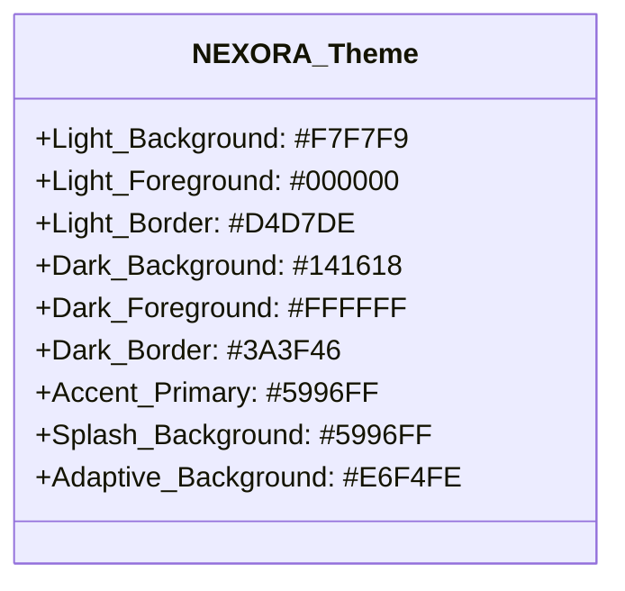

# Branding and Application Identity Map — NEXORA AI

## 1. Core Identity Coordinates

| Property | Original Value | NEXORA AI Target Value | Status |
| :--- | :--- | :--- | :--- |
| **App Name** | `Mobile Agent` | **`NEXORA AI`** | Configured |
| **App Slug** | `mobile-agent` | **`nexora-ai`** | Configured |
| **Android Package Name** | `com.tecnicalbot.mobileagent` | **`com.nexora.ai`** | Configured |
| **iOS Bundle Identifier** | `com.tecnicalbot.mobileagent` | **`com.nexora.ai`** | Configured |
| **URL Scheme** | `mobile-agent://` | **`nexora-ai://`** | Configured |
| **Expo Owner** | `tecnicalbot` | *(Removed / Decoupled)* | Decoupled |
| **Database File** | `nexora-ai.db` | **`nexora-ai.db`** (Preserved) | Preserved |

---

## 2. Visual Assets Replacement Inventory

All visual assets reside in the [assets/](file:///storage/emulated/0/arya1/assets/) directory:

| Asset File Path | Dimensions | Current Role | NEXORA AI Replacement Requirements |
| :--- | :--- | :--- | :--- |
| `assets/images/icon.png` | 1024x1024 PNG | Primary application launcher icon | High-resolution modern NEXORA AI logo icon |
| `assets/images/adaptive-icon.png` | 1024x1024 PNG | Android adaptive icon foreground | Centered NEXORA AI glyph with transparent background |
| `assets/images/splash-icon.png` | 1024x1024 PNG | Splash screen centered logo | Minimalist NEXORA AI emblem |
| `assets/images/splash.png` | 2048x2048 PNG | Full splash screen image | Branded NEXORA AI launch graphic |
| `assets/images/notification-icon.png` | 96x96 PNG (Monochrome) | Android status bar notification | Transparent monochrome silhouette icon |
| `assets/images/favicon.png` | 48x48 PNG | Web preview favicon | NEXORA AI square favicon |
| `assets/expo.icon/icon.json` | JSON Catalog | iOS vector asset catalog | Configured with NEXORA AI vector layers |

---

## 3. UI Text & System Branding References

| File Path | Current Line / String | Proposed NEXORA AI Replacement |
| :--- | :--- | :--- |
| `src/components/ui/app-sidebar.tsx` | Line 227: `<Text ...>Mobile Agent</Text>` | `<Text ...>NEXORA AI</Text>` |
| `src/providers/app-state/constants.ts` | Line 14: `# You are Mobile Agent, an elite assistant built by Technical Bot.` | `# You are NEXORA AI, an advanced autonomous mobile intelligence assistant.` |
| `src/providers/app-state/constants.ts` | Line 17: `- Docs: https://mobile-agent.vercel.app/docs` | `- Docs: https://github.com/stylesheet48-max/nexora-ai#readme` |
| `src/providers/app-state/constants.ts` | Line 18: `- Issues: https://github.com/TecnicalBot/mobile-agent/issues` | `- Issues: https://github.com/stylesheet48-max/nexora-ai/issues` |
| `src/modules/plugins/manifest.ts` | Line 5: `'Not a Mobile Agent plugin: ...'` | `'Not a NEXORA AI plugin: ...'` |
| `src/modules/providers/openai-client.ts`| Line 122: `User-Agent: mobile-agent/1.1.0` | `User-Agent: nexora-ai/1.1.0` |
| `src/modules/providers/openai-client.ts`| Line 287: `"HTTP-Referer": "https://mobile-agent.local"` | `"HTTP-Referer": "https://nexora.ai.local"` |
| `src/modules/providers/openai-client.ts`| Line 288: `"X-Title": "mobile-agent"` | `"X-Title": "nexora-ai"` |
| `src/hooks/use-acp-harness.ts` | Line 197-198: `name: "mobile-agent", title: "Mobile Agent"` | `name: "nexora-ai", title: "NEXORA AI"` |
| `src/components/chat/export-chat-drawer.tsx` | Line 159: `"mobile-agent"` | `"nexora-ai"` |

---

## 4. Theme & Color Palette

NEXORA AI utilizes the centralized design token system defined in [src/constants/theme-tokens.js](file:///storage/emulated/0/arya1/src/constants/theme-tokens.js):

- **Light Mode**: Clean minimalist paper background (`#F7F7F9`) with slate borders (`#D4D7DE`).
- **Dark Mode**: Deep OLED black/charcoal background (`#141618`) with subtle card borders (`#3A3F46`).
- **Brand Accent**: Electric Cobalt Blue (`#5996FF`) used in the splash screen background and primary interaction highlights.

---

## 5. Storage Namespaces & Companion Tokens

To preserve data integrity while transitioning to the new brand:

1. **Database File (PRESERVED)**:  
   The SQLite database remains `nexora-ai.db`. Renaming it would wipe existing user chat history; preserving the filename guarantees 100% backward compatibility.
2. **Workspace Segments**:  
   [src/core/services/workspace-file-service.ts](file:///storage/emulated/0/arya1/src/core/services/workspace-file-service.ts#L34): `WORKSPACE_ROOT_SEGMENTS = ["mobile-agent", "workspace"]`. Can be kept or transparently migrated to `["nexora-ai", "workspace"]` on fresh runs.
3. **Bridge Token Path**:  
   [tools/acp-bridge/bridge.mjs](file:///storage/emulated/0/arya1/tools/acp-bridge/bridge.mjs#L68): Defaults to `~/.config/mobile-agent/bridge-token`. Updated to `~/.config/nexora-ai/bridge-token`.
4. **Bridge Pairing Protocol**:  
   [src/modules/harnesses/acp-pairing.ts](file:///storage/emulated/0/arya1/src/modules/harnesses/acp-pairing.ts#L6): `ACP_PAIRING_TYPE = "nexora-ai-acp-pair"` (matches bridge script).
