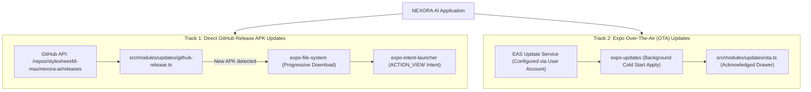

# Build, Release & Update Architecture Plan — NEXORA AI

## 1. Dual-Track Update Architecture

NEXORA AI features two complementary, production-tested update mechanisms:



---

## 2. In-App GitHub APK Updater Deep Dive

Implemented in [src/modules/updates/github-release.ts](file:///storage/emulated/0/arya1/src/modules/updates/github-release.ts):

1. **Version Checking**: Compares the installed version in `Constants.expoConfig.version` against GitHub release tags using semantic versioning (`isNewerVersion`).
2. **Asset Resolution**: Filters release assets for `.apk` files.
3. **Resumable Download**: Downloads the APK file into `Paths.cache` with real-time download progress reporting.
4. **Android Package Installer Launch**: Once downloaded, triggers Android's package installer:
   ```typescript
   await IntentLauncher.startActivityAsync("android.intent.action.VIEW", {
     data: apk.contentUri,
     flags: 1, // FLAG_GRANT_READ_URI_PERMISSION
     type: "application/vnd.android.package-archive",
   });
   ```
5. **Decoupling Target**:
   `RELEASES_API_URL` points to `https://api.github.com/repos/stylesheet48-max/nexora-ai/releases`.

---

## 3. Local Android Builds vs Cloud EAS Builds

| Build Mode | Command | Dependencies Required | Network Requirement | Role in NEXORA AI |
| :--- | :--- | :--- | :--- | :--- |
| **Local Gradle Build** | `pnpm android` (`expo run:android`) | Android SDK, JDK 17, local NDK | None (Offline once cached) | **Primary developer build method** |
| **Throttled Local EAS**| `./scripts/eas-build-local.sh` | Local EAS CLI, systemd, Gradle | None | Assembles production release APK locally |
| **Cloud EAS Build** | `eas build --platform android` | Expo Account, `EXPO_TOKEN` | Continuous high-speed Internet | Optional; configured when User provides EAS account |

### Memory Throttling in `scripts/eas-build-local.sh`:
Compiling React Native with C++ LiteRT and Reanimated can easily exhaust RAM. The local build script limits CPU to 400% and caps Gradle memory to 8 GB (`org.gradle.jvmargs=-Xmx8g -XX:MaxMetaspaceSize=2g`), preventing out-of-memory errors on local workstations.

---

## 4. GitHub Actions CI/CD Pipeline

The `.github/workflows/` directory contains automated release workflows:

### 1. `android.yml` (APK Build & GitHub Release)
- **Trigger**: Push to `main` branch when `package.json` version increases.
- **Actions**:
  1. Compares version against git tags.
  2. Runs EAS build to produce release APK.
  3. Downloads the APK artifact as `nexora-ai-${{ env.VERSION }}.apk`.
  4. Merges `.release-notes.md` using `scripts/merge-release-notes.mjs`.
  5. Publishes a new GitHub Release with tag `v${{ env.VERSION }}` on `stylesheet48-max/nexora-ai`.

### 2. `eas-update.yml` (OTA Publishing Guard)
- **Safety Guard**: Diffs the pushed commit range. If any native-impacting files (`package.json`, `app.json`, `modules/`, `plugins/`, `android/`) have changed, OTA publishing is automatically **aborted** to prevent shipping broken JS bundles to incompatible native runtimes.
- If only documentation, catalogs, or JS code changed, it publishes an OTA update.
