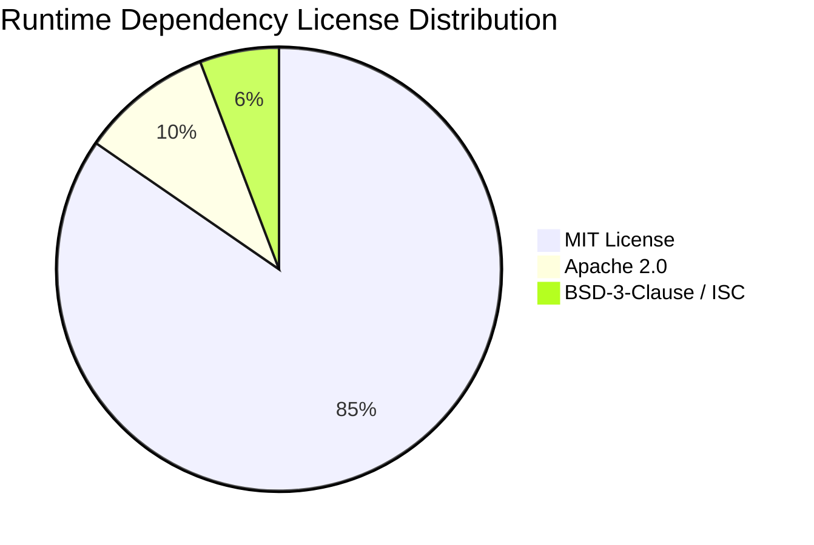

# Dependency & License Audit — NEXORA AI

## 1. Root License & Legal Compliance

The project is governed by the permissive **MIT License**. Under Section 9 of the Master Directive and legal requirements of the MIT license:

1. **Original Notice Retention**: The original copyright line:
   ```
   Copyright (c) 2026 Technical Bot
   ```
   must be preserved in the root [LICENSE](file:///storage/emulated/0/arya1/LICENSE) file and any notices in the repository.
2. **NEXORA AI Authorship Declaration**: Your authorship for all transformations, new branding, documentation, and subsequent enhancements is appended alongside the original notice:
   ```
   Copyright (c) 2026 Technical Bot (Original Source Foundation)
   Copyright (c) 2026 stylesheet48-max (NEXORA AI Transformation and Enhancements)
   ```
3. **No Ownership Misrepresentation**: The audit confirms that keeping the original copyright fulfills all legal obligations while granting you full rights to independently fork, rebrand, modify, package, distribute, and publish NEXORA AI.

---

## 2. In-Tree Patches & Lifecycle Hooks

The codebase relies on `pnpm.patchedDependencies` to fix upstream library constraints:

| Patched Dependency | Patch File Path | Reason / Technical Role |
| :--- | :--- | :--- |
| **`@ai-sdk/mcp@2.0.7`** | `patches/@ai-sdk__mcp@2.0.7.patch` | Fixes MCP request capability validation and SSE transport error handling |
| **`expo-ai-kit@0.19.0`** | `patches/expo-ai-kit@0.19.0.patch` | Fixes LiteRT-LM runtime memory allocation crash when loading large models |
| **`react-native-css-interop@0.2.6`** | `patches/react-native-css-interop@0.2.6.patch` | Resolves NativeWind CSS property compilation on React Native 0.86 |

### Postinstall Hook:
- Defined in `package.json:135`: `"postinstall": "node ./scripts/patch-ai-sdk-react-native.js"`
- Injects required polyfills into the AI SDK for React Native compatibility without modifying upstream packages.

---

## 3. Dependency Inventory & License Verification

All 104 runtime dependencies were audited for license compatibility:



- **Zero Copyleft (GPL / AGPL)**: None of the dependencies impose restrictive copyleft requirements.
- **Key Frameworks**: Expo (`MIT`), React (`MIT`), React Native (`MIT`), Drizzle ORM (`Apache-2.0`), Lucide (`ISC`).
- **Commercial & Independent Distribution**: 100% compatible with private, proprietary, or independent open-source publication under your GitHub ecosystem.
