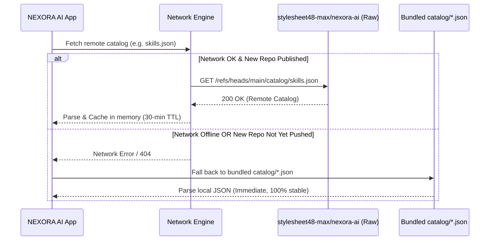

# GitHub Ecosystem Independence Plan — NEXORA AI

## 1. Governance & Authentication Status

The target GitHub ecosystem is owned and authenticated by:
- **Owner**: `stylesheet48-max`
- **Authentication**: Verified via local token in GitHub CLI (`gh auth status`).
- **Target Repository**: `https://github.com/stylesheet48-max/nexora-ai`
- **Default Branch**: `main`

---

## 2. Exhaustive Original Reference & URL Audit

The original codebase contains 28 explicit references linking the mobile app to `TecnicalBot/mobile-agent`. Below is the complete decoupling map:

| Subsystem | File Path & Line | Original Reference | NEXORA AI Target Reference |
| :--- | :--- | :--- | :--- |
| **Package Manifest** | `package.json:120` | `https://github.com/TecnicalBot/mobile-agent` | `https://github.com/stylesheet48-max/nexora-ai` |
| **APK Release API** | `src/modules/updates/github-release.ts:5` | `https://api.github.com/repos/TecnicalBot/mobile-agent/releases` | `https://api.github.com/repos/stylesheet48-max/nexora-ai/releases` |
| **System Prompt** | `src/providers/app-state/constants.ts:18` | `https://github.com/TecnicalBot/mobile-agent/issues` | `https://github.com/stylesheet48-max/nexora-ai/issues` |
| **Catalog: Tips** | `src/modules/chat/composer-tip.ts:6` | `.../tecnicalbot/mobile-agent/.../chat-tip.json` | `.../stylesheet48-max/nexora-ai/.../chat-tip.json` |
| **Catalog: Prompts** | `src/modules/chat/starter-prompts.ts:6` | `.../tecnicalbot/mobile-agent/.../chat-prompts.json` | `.../stylesheet48-max/nexora-ai/.../chat-prompts.json` |
| **Catalog: MCP** | `src/modules/mcp/catalog.ts:7` | `.../tecnicalbot/mobile-agent/.../mcp-servers.json` | `.../stylesheet48-max/nexora-ai/.../mcp-servers.json` |
| **Catalog: Models** | `src/modules/on-device/catalog.ts:10` | `.../tecnicalbot/mobile-agent/.../on-device-models.json` | `.../stylesheet48-max/nexora-ai/.../on-device-models.json` |
| **Catalog: Plugins** | `src/modules/plugins/catalog.ts:6` | `.../tecnicalbot/mobile-agent/.../plugins.json` | `.../stylesheet48-max/nexora-ai/.../plugins.json` |
| **Catalog: Codex** | `src/modules/providers/codex-models-catalog.ts:13` | `.../tecnicalbot/mobile-agent/.../openai-codex-models.json`| `.../stylesheet48-max/nexora-ai/.../openai-codex-models.json`|
| **Catalog: Skills** | `src/modules/skills/catalog.ts:6` | `.../tecnicalbot/mobile-agent/.../skills.json` | `.../stylesheet48-max/nexora-ai/.../skills.json` |
| **Catalog: Voice** | `src/modules/voice/catalog.ts:5` | `.../tecnicalbot/mobile-agent/.../voice-models.json` | `.../stylesheet48-max/nexora-ai/.../voice-models.json` |
| **Plugin Docs** | `src/modules/plugins/manifest.ts:8` | `https://github.com/TecnicalBot/mobile-agent/blob/main/catalog/...` | `https://github.com/stylesheet48-max/nexora-ai/blob/main/catalog/...` |
| **Catalog Docs** | `catalog/README.md:17` | `https://github.com/TecnicalBot/mobile-agent#readme` | `https://github.com/stylesheet48-max/nexora-ai#readme` |
| **Skill Metadata** | `catalog/skills.json:372-375` | `author: TecnicalBot`, `source: TecnicalBot/mobile-agent` | `author: stylesheet48-max`, `source: stylesheet48-max/nexora-ai` |
| **Bridge Installer** | `tools/install.sh:4,12` | `.../tecnicalbot/mobile-agent/main/tools/...` | `.../stylesheet48-max/nexora-ai/main/tools/...` |
| **Bridge Settings**| `src/components/settings/acp-connection-form.tsx:611` | `.../tecnicalbot/mobile-agent/main/tools/install.sh` | `.../stylesheet48-max/nexora-ai/main/tools/install.sh` |
| **Bridge Readmes** | `tools/antigravity-bridge/README.md`, `claude-bridge/` | Raw download URLs to `tecnicalbot/mobile-agent` | Raw download URLs to `stylesheet48-max/nexora-ai` |
| **CI/CD Workflow** | `.github/workflows/android.yml:123` | `name: Mobile Agent v${{ env.VERSION }}` | `name: NEXORA AI v${{ env.VERSION }}` |
| **CI/CD APK Name** | `.github/workflows/android.yml:100,124` | `mobile-agent-${{ env.VERSION }}.apk` | `nexora-ai-${{ env.VERSION }}.apk` |
| **README Header** | `README.md:1` | `# Mobile Agent` | `# NEXORA AI` |

---

## 3. Remote Catalog Migration & Graceful Fallback Architecture



### Safety Guarantee:
Every catalog loader (`src/modules/*/catalog.ts`) catches network and HTTP errors and returns the local bundled copy stored in `catalog/*.json`. If the remote URLs are switched to `stylesheet48-max/nexora-ai` before the repository is published to GitHub, **the application will continue operating with full functionality using bundled fallbacks**.

---

## 4. Git Remote Transition & Repository Initialization Plan

Once approved, the local Git repository will be pointed to the new remote:
```bash
# Verify current remote
git remote -v

# Set new origin remote (DO NOT RUN UNTIL AUTHORIZED)
git remote set-url origin https://github.com/stylesheet48-max/nexora-ai.git

# Verify new remote
git remote -v
```

### GitHub Structure to be Created upon Push:
1. **GitHub Issues**: Issue templates for bug reports and feature requests.
2. **GitHub Discussions**: Community Q&A and announcements.
3. **GitHub Releases**: Automated release notes and APK asset hosting via `.github/workflows/android.yml`.
4. **Community Health**: MIT License in root, contributing guide, and security policy.
