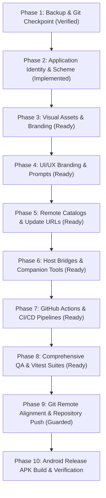

# Implementation Roadmap — NEXORA AI

## 1. Phased Execution Overview

The transformation is structured into **10 controlled phases**. Each phase is gated: implementation cannot advance to subsequent stages without completing the designated verification checklist and receiving user authorization.

---

## 2. Phase-by-Phase Roadmap

### Phase 1: Backup & Git Checkpoint
- **Status**: **COMPLETED**
- **Artifact**: Git branch `checkpoint-before-topic3` created.
- **Verification**: Clean working tree verified; rollback tested and available.

### Phase 2: Application Identity & Scheme Configuration
- **Status**: **IMPLEMENTED & VERIFIED**
- **Files Modified**: `app.json`, `package.json`, `src/app/+native-intent.tsx`, `ProcessTextActivity.kt`, `src/hooks/use-acp-harness.ts`, and 3 OAuth modules.
- **Verification**: JSON syntax valid; model catalog integrity passed.

### Phase 3: Visual Assets & Branding
- **Objective**: Replace original app icons with modern NEXORA AI branded graphics.
- **Actions**:
  1. Generate / place `assets/images/icon.png` (1024x1024).
  2. Generate / place `assets/images/adaptive-icon.png` (1024x1024).
  3. Generate / place `assets/images/splash-icon.png` and `splash.png`.
  4. Generate / place `assets/images/notification-icon.png` (96x96 monochrome).
  5. Generate / place `assets/images/favicon.png` (48x48).
- **Gate Check**: Assets match target resolutions and transparency requirements.

### Phase 4: UI/UX Branding & Persona
- **Objective**: Align user interface text and default system prompts.
- **Actions**:
  1. Update `src/components/ui/app-sidebar.tsx` header text to `"NEXORA AI"`.
  2. Update `src/providers/app-state/constants.ts` system prompt to `"You are NEXORA AI..."` and point support links to `stylesheet48-max/nexora-ai`.
  3. Update `src/modules/plugins/manifest.ts` error message string.
  4. Update `src/modules/providers/openai-client.ts` User-Agent header.
- **Gate Check**: Start fresh chat; verify assistant persona and sidebar title.

### Phase 5: Remote Catalogs & Release Endpoints
- **Objective**: Point all remote catalog loaders to `stylesheet48-max/nexora-ai`.
- **Actions**:
  1. Update `src/modules/updates/github-release.ts` release check URL.
  2. Update 8 catalog loader files in `src/modules/*/catalog.ts`.
  3. Update `catalog/skills.json` html-video author and repository links.
  4. Update `catalog/README.md`.
- **Gate Check**: `node scripts/verify-model-catalog.mjs` passes cleanly.

### Phase 6: Host Bridges & Companion Tools
- **Objective**: Align desktop coding agent bridges with NEXORA AI identity.
- **Actions**:
  1. Update `tools/install.sh` download URLs and `~/.config/nexora-ai/bridge-token` path.
  2. Update `tools/acp-bridge/bridge.mjs` pairing type `nexora-ai-acp-pair`.
  3. Update `src/modules/harnesses/acp-pairing.ts` pairing type.
  4. Update `tools/antigravity-bridge/README.md` and `tools/claude-bridge/README.md`.
- **Gate Check**: Bridge test script starts and outputs `nexora-ai` token and QR code.

### Phase 7: GitHub Actions & CI/CD Pipelines
- **Objective**: Prepare automated GitHub workflows for your repository.
- **Actions**:
  1. Update `.github/workflows/android.yml` release name and APK asset name to `nexora-ai-${{ env.VERSION }}.apk`.
  2. Retain `.github/workflows/ci.yml` for automated PR and push validation.
  3. Keep `.github/workflows/eas-update.yml` guarded.
- **Gate Check**: YAML linting passes; workflow syntax validated.

### Phase 8: Comprehensive QA & Testing
- **Objective**: Run full test suites and static analysis.
- **Actions**:
  1. `pnpm exec tsc --noEmit` (TypeScript validation).
  2. `pnpm test` (All Vitest unit tests).
  3. Catalog verification diagnostics.
- **Gate Check**: Zero failing tests, zero unhandled errors.

### Phase 9: Git Remote Alignment & Repository Push
- **Objective**: Publish NEXORA AI to your GitHub account.
- **Actions**:
  1. Request explicit User authorization.
  2. Point git remote `origin` to `https://github.com/stylesheet48-max/nexora-ai.git`.
  3. Push `main` branch to remote.
- **Gate Check**: Remote repository populated on GitHub; all links resolve.

### Phase 10: Android Release APK Build & Verification
- **Objective**: Compile and sign production Android APK.
- **Actions**:
  1. Execute local production build via `./scripts/eas-build-local.sh prod` or Gradle.
  2. Verify APK package ID `com.nexora.ai` and launch on physical device.
- **Gate Check**: APK installs cleanly alongside existing apps; passes full 12-scenario QA matrix.
