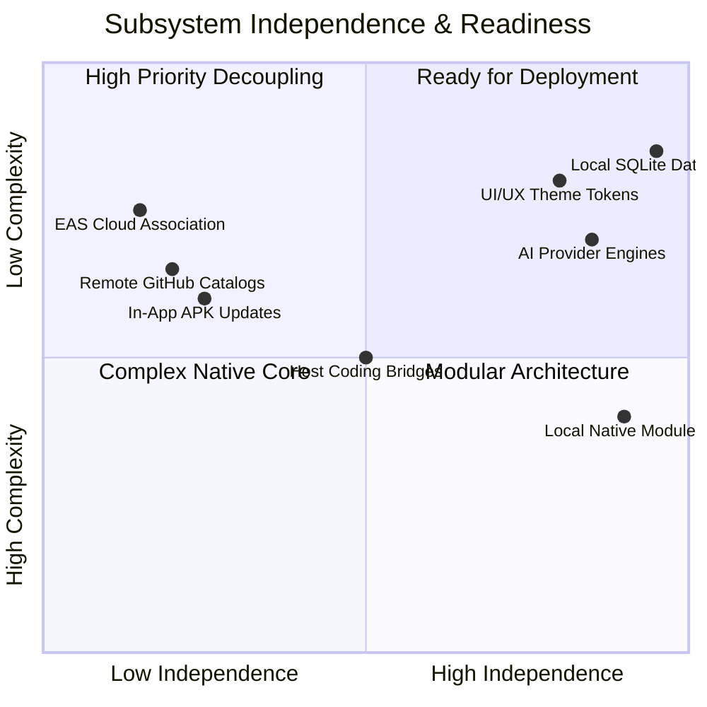

# NEXORA AI — Master Repository Audit & Transformation Report

## Executive Summary

This Master Audit Report provides an exhaustive, multi-disciplinary engineering analysis for transforming the cloned **Mobile Agent** application (`https://github.com/TecnicalBot/mobile-agent.git`) into **NEXORA AI** (`https://github.com/stylesheet48-max/nexora-ai`), an independently branded, independently managed, and self-contained mobile AI agent platform for Android.

The project strictly follows the **No New Features / Complete Feature Preservation** doctrine. The existing source code serves as the bedrock. Every existing subsystem—including all cloud and local AI provider integrations, memory, MCP, skills, plugins, voice, background services, exact alarm schedulers, Termux bridge, SAF file operations, video rendering, and document processing—is meticulously audited and preserved.

---

## 1. Project Identity & Governance

| Attribute | Original Reference | NEXORA AI Target |
| :--- | :--- | :--- |
| **Application Name** | `Mobile Agent` | **`NEXORA AI`** |
| **GitHub Account** | `TecnicalBot` | **`stylesheet48-max`** (Authenticated via local environment) |
| **Source Repository** | `https://github.com/TecnicalBot/mobile-agent` | **`https://github.com/stylesheet48-max/nexora-ai`** |
| **Application Slug** | `mobile-agent` | **`nexora-ai`** |
| **Application Scheme** | `mobile-agent://` | **`nexora-ai://`** |
| **Android Package ID** | `com.tecnicalbot.mobileagent` | **`com.nexora.ai`** |
| **iOS Bundle Identifier** | `com.tecnicalbot.mobileagent` | **`com.nexora.ai`** |
| **Database File** | `nexora-ai.db` | **`nexora-ai.db`** (Preserved without renaming) |
| **License** | MIT License | **MIT License** (Original copyright preserved; new notices appended) |

---

## 2. Multi-Disciplinary Audit Scorecard

| Audit Dimension | Status | Key Findings | Cross-Reference |
| :--- | :--- | :--- | :--- |
| **A. Architecture** | Verified | Client-side Local-First; Expo SDK 57 / React Native 0.86; 11 local native modules; 8 config plugins. | [REPOSITORY_ARCHITECTURE.md](file:///storage/emulated/0/arya1/docs/audit/REPOSITORY_ARCHITECTURE.md) |
| **B. Features** | Verified | 24 core capabilities identified; zero removals permitted. | [FEATURE_INVENTORY.md](file:///storage/emulated/0/arya1/docs/audit/FEATURE_INVENTORY.md) |
| **C. Branding** | Mapped | App name, icons, splash, sidebar, notification icon, theme tokens identified. | [BRANDING_AND_IDENTITY_MAP.md](file:///storage/emulated/0/arya1/docs/audit/BRANDING_AND_IDENTITY_MAP.md) |
| **D. UI/UX** | Mapped | Radix/shadcn inspired NativeWind v4 primitives; theme tokens; drawer navigation. | [UI_UX_TRANSFORMATION_PLAN.md](file:///storage/emulated/0/arya1/docs/audit/UI_UX_TRANSFORMATION_PLAN.md) |
| **E. GitHub Independence** | Complete Plan | 28 distinct files referencing `TecnicalBot` identified with full migration targets. | [GITHUB_INDEPENDENCE_PLAN.md](file:///storage/emulated/0/arya1/docs/audit/GITHUB_INDEPENDENCE_PLAN.md) |
| **F. Developer References**| Cataloged | All documentation, badges, links, issues, and discussions references mapped. | [GITHUB_INDEPENDENCE_PLAN.md](file:///storage/emulated/0/arya1/docs/audit/GITHUB_INDEPENDENCE_PLAN.md) |
| **G. External URLs** | Cataloged | YouTube demo, Vercel docs, GitHub endpoints cataloged for replacement. | [API_AND_EXTERNAL_SERVICES.md](file:///storage/emulated/0/arya1/docs/audit/API_AND_EXTERNAL_SERVICES.md) |
| **H. Catalogs & Models** | Verified | 8 remote JSON catalogs; 30-min in-memory cache; local bundled fallbacks verified. | [API_AND_EXTERNAL_SERVICES.md](file:///storage/emulated/0/arya1/docs/audit/API_AND_EXTERNAL_SERVICES.md) |
| **I. Backend & Database** | Verified | 100% serverless client architecture; SQLite `nexora-ai.db` with 20 tables & 28 migrations. | [BACKEND_DATABASE_AUDIT.md](file:///storage/emulated/0/arya1/docs/audit/BACKEND_DATABASE_AUDIT.md) |
| **J. AI Providers** | Preserved | Direct HTTPS client SDKs for Gemini, OpenAI, Claude, xAI, Ollama, OpenRouter. | [API_AND_EXTERNAL_SERVICES.md](file:///storage/emulated/0/arya1/docs/audit/API_AND_EXTERNAL_SERVICES.md) |
| **K. OAuth & Deep Links** | Verified | OpenAI, OpenRouter, and MCP OAuth flows mapped to `nexora-ai://`. | [API_AND_EXTERNAL_SERVICES.md](file:///storage/emulated/0/arya1/docs/audit/API_AND_EXTERNAL_SERVICES.md) |
| **L. Native Android** | Verified | 11 custom native modules in `modules/` using Kotlin and Android Jetpack. | [ANDROID_NATIVE_AUDIT.md](file:///storage/emulated/0/arya1/docs/audit/ANDROID_NATIVE_AUDIT.md) |
| **M. Permissions & Services**| Verified | Android foreground service, wake locks, exact alarms, boot receivers verified. | [ANDROID_NATIVE_AUDIT.md](file:///storage/emulated/0/arya1/docs/audit/ANDROID_NATIVE_AUDIT.md) |
| **N. Security & Privacy** | Verified | Hardware-backed `SecureStore` for credentials; zero credential leakage in DB. | [SECURITY_AND_PRIVACY_AUDIT.md](file:///storage/emulated/0/arya1/docs/audit/SECURITY_AND_PRIVACY_AUDIT.md) |
| **O. Dependencies & License**| Verified | MIT License compliance; 3 in-tree patches in `patches/`; 104 production dependencies. | [DEPENDENCY_AND_LICENSE_AUDIT.md](file:///storage/emulated/0/arya1/docs/audit/DEPENDENCY_AND_LICENSE_AUDIT.md) |
| **P. Expo & EAS** | Decoupled | Original EAS project ID `7944daea...` and owner removed; local build ready. | [BUILD_RELEASE_AND_UPDATE_PLAN.md](file:///storage/emulated/0/arya1/docs/audit/BUILD_RELEASE_AND_UPDATE_PLAN.md) |
| **Q. Build & Release** | Verified | Local Gradle builds (`pnpm android`) & local EAS APK builds intact. | [BUILD_RELEASE_AND_UPDATE_PLAN.md](file:///storage/emulated/0/arya1/docs/audit/BUILD_RELEASE_AND_UPDATE_PLAN.md) |
| **R. Updates** | Mapped | In-app APK updater and OTA state machine audited for independent repo release. | [BUILD_RELEASE_AND_UPDATE_PLAN.md](file:///storage/emulated/0/arya1/docs/audit/BUILD_RELEASE_AND_UPDATE_PLAN.md) |
| **S. Testing & QA** | Planned | Vitest unit test suite; catalog verification diagnostics; manual verification plan. | [TESTING_AND_QA_PLAN.md](file:///storage/emulated/0/arya1/docs/audit/TESTING_AND_QA_PLAN.md) |

---

## 3. Transformation Strategy & Execution Phases

The transformation is strictly divided into 7 controlled phases:

1. **PHASE A — Audit**: Systematic, safe read-only repository diagnostics and code inspection. *(Completed)*
2. **PHASE B — Documentation**: Authoring the complete set of 17 cross-referenced audit documents in `docs/audit/`. *(Current Phase)*
3. **PHASE C — Review**: Presenting the full audit suite to the User for architectural review.
4. **PHASE D — Approval**: Receiving explicit User authorization prior to any code implementation.
5. **PHASE E — Implementation**: Staged execution of approved changes (Identity, Assets, UI/UX, Endpoints, Workflows).
6. **PHASE F — Testing**: Comprehensive testing (TypeScript, Linting, Unit Tests, Model Catalog diagnostics).
7. **PHASE G — Final Build**: Release readiness verification, Android APK assembly, and release packaging.

---

## 4. Documentation Index

The complete audit suite consists of the following 17 dedicated documents located in [docs/audit/](file:///storage/emulated/0/arya1/docs/audit/):

1. **[MASTER_AUDIT_REPORT.md](file:///storage/emulated/0/arya1/docs/audit/MASTER_AUDIT_REPORT.md)**: Overall synthesis, executive summary, and project governance.
2. **[REPOSITORY_ARCHITECTURE.md](file:///storage/emulated/0/arya1/docs/audit/REPOSITORY_ARCHITECTURE.md)**: Technical stack, folder structure, monorepo setup, build pipeline.
3. **[FEATURE_INVENTORY.md](file:///storage/emulated/0/arya1/docs/audit/FEATURE_INVENTORY.md)**: Exhaustive breakdown of all 24 existing features and their preservation criteria.
4. **[BRANDING_AND_IDENTITY_MAP.md](file:///storage/emulated/0/arya1/docs/audit/BRANDING_AND_IDENTITY_MAP.md)**: Complete before/after visual assets, names, icons, and theme tokens.
5. **[GITHUB_INDEPENDENCE_PLAN.md](file:///storage/emulated/0/arya1/docs/audit/GITHUB_INDEPENDENCE_PLAN.md)**: Strategy for decoupling from `TecnicalBot` to `stylesheet48-max`.
6. **[BACKEND_DATABASE_AUDIT.md](file:///storage/emulated/0/arya1/docs/audit/BACKEND_DATABASE_AUDIT.md)**: SQLite architecture, Drizzle schemas, 28 migrations, SecureStore.
7. **[API_AND_EXTERNAL_SERVICES.md](file:///storage/emulated/0/arya1/docs/audit/API_AND_EXTERNAL_SERVICES.md)**: Catalog of all cloud APIs, OAuth providers, and fallback mechanisms.
8. **[UI_UX_TRANSFORMATION_PLAN.md](file:///storage/emulated/0/arya1/docs/audit/UI_UX_TRANSFORMATION_PLAN.md)**: Component architecture, design tokens, navigation, and theme customization.
9. **[ANDROID_NATIVE_AUDIT.md](file:///storage/emulated/0/arya1/docs/audit/ANDROID_NATIVE_AUDIT.md)**: 11 native modules, 8 config plugins, background services, permissions.
10. **[SECURITY_AND_PRIVACY_AUDIT.md](file:///storage/emulated/0/arya1/docs/audit/SECURITY_AND_PRIVACY_AUDIT.md)**: Threat model, credential storage, network security, local data protection.
11. **[DEPENDENCY_AND_LICENSE_AUDIT.md](file:///storage/emulated/0/arya1/docs/audit/DEPENDENCY_AND_LICENSE_AUDIT.md)**: MIT compliance, third-party licenses, in-tree patches audit.
12. **[BUILD_RELEASE_AND_UPDATE_PLAN.md](file:///storage/emulated/0/arya1/docs/audit/BUILD_RELEASE_AND_UPDATE_PLAN.md)**: Local Android builds, EAS decoupling, GitHub Actions release pipeline.
13. **[TESTING_AND_QA_PLAN.md](file:///storage/emulated/0/arya1/docs/audit/TESTING_AND_QA_PLAN.md)**: Unit tests, regression matrix, manual testing on Android devices.
14. **[FILE_BY_FILE_CHANGE_MAP.md](file:///storage/emulated/0/arya1/docs/audit/FILE_BY_FILE_CHANGE_MAP.md)**: Granular file-by-file audit with action classifications.
15. **[IMPLEMENTATION_ROADMAP.md](file:///storage/emulated/0/arya1/docs/audit/IMPLEMENTATION_ROADMAP.md)**: Step-by-step phased execution sequence.
16. **[PROJECT_DECISION_LOG.md](file:///storage/emulated/0/arya1/docs/audit/PROJECT_DECISION_LOG.md)**: Formal record of all approved engineering decisions.
17. **[FINAL_ACCEPTANCE_CHECKLIST.md](file:///storage/emulated/0/arya1/docs/audit/FINAL_ACCEPTANCE_CHECKLIST.md)**: Comprehensive verification criteria for sign-off.
