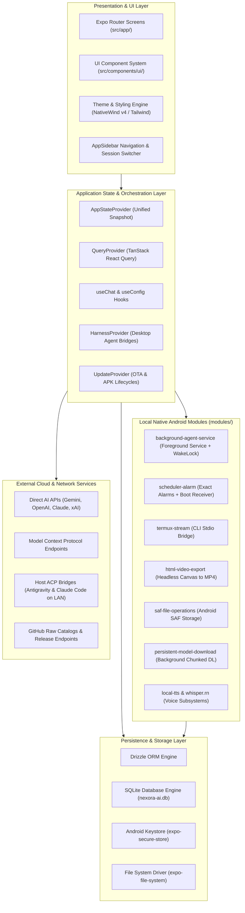
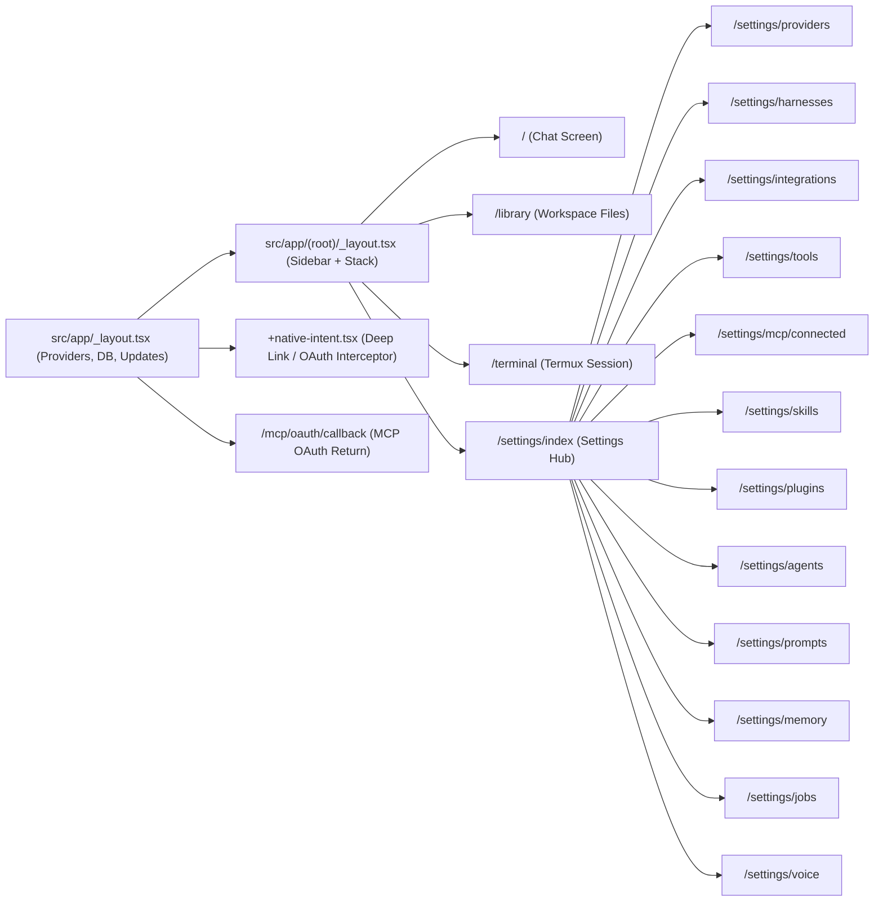

# Repository Architecture Audit — NEXORA AI

## 1. Architectural Overview

NEXORA AI is architected as an offline-first, client-driven mobile AI platform. Unlike traditional mobile applications that rely on proprietary cloud backends to route AI requests, store conversational history, and manage user state, NEXORA AI executes all application state logic, local database persistence, tool orchestration, and background scheduling directly on the Android device.



---

## 2. Technology Stack Matrix

| Subsystem | Technology | Version | Purpose |
| :--- | :--- | :--- | :--- |
| **Mobile Framework** | Expo SDK | `~57.0.27` | Application lifecycle, cross-platform runtime, build plugins |
| **Core Runtime** | React Native | `0.86.3` | Native Android bridge, Hermes JavaScript engine |
| **UI Library** | React | `19.2.3` | Declarative UI rendering, Concurrent Mode, React Compiler |
| **Language** | TypeScript | `~6.0.3` | Type safety, static verification, schema synchronization |
| **Navigation** | Expo Router | `~57.0.25` | File-based routing, native stack navigation, deep-link handling |
| **Database Engine** | Expo SQLite | `~57.0.4` | Native SQLite 3 driver with Write-Ahead Logging (WAL) |
| **ORM / Data Access** | Drizzle ORM | `^0.45.2` | Type-safe schema definition, relational mapping, query builder |
| **Credential Storage**| Expo SecureStore | `~57.0.4` | Android Keystore backed hardware encryption for API keys |
| **Styling Engine** | NativeWind | `^4.2.6` | Tailwind CSS compiler for React Native StyleSheet |
| **CSS Compiler** | Tailwind CSS | `^3.4.19` | Design token extraction and utility classes |
| **Animation Library** | Reanimated | `4.5.1` | Native thread UI animations, gesture interactions |
| **Icons** | Lucide React Native | `^1.22.0` | SVG-based vector iconography |
| **AI Client SDK** | Vercel AI SDK Core | `^7.0.9` | Unified streaming AI completion and tool calling pipeline |
| **AI Provider SDKs** | `@ai-sdk/google`, `@ai-sdk/openai`, `@ai-sdk/anthropic`, `@ai-sdk/xai` | `^4.0.x` | Native provider drivers with tool calling and multimodal support |
| **MCP Client** | `@modelcontextprotocol/sdk`, `@ai-sdk/mcp` | `^1.32.2` | Model Context Protocol client implementation (HTTP/SSE) |
| **On-Device LLM** | `expo-ai-kit` (LiteRT-LM) | `0.19.0` (patched)| On-device local language model execution (Gemma, LFM) |
| **On-Device STT** | `whisper.rn` | `^0.7.4` | Offline Whisper speech-to-text inference |
| **Document Tools** | `pdf-lib`, `docx`, `pptxgenjs`, `xlsx`, `unpdf` | Latest | Client-side document reading, editing, diffing, and creation |
| **Testing Framework**| Vitest | `^4.1.10` | Fast unit, integration, and mocking test runner |
| **Package Manager** | pnpm | `10.29.2` | Monorepo package management, lockfile determinism |

---

## 3. Directory Structure Anatomy

```
arya1/
├── app.json                       # Primary Expo & Android manifest configuration
├── package.json                   # Root dependencies, scripts, and monorepo config
├── pnpm-workspace.yaml            # pnpm workspace configuration defining modules/
├── pnpm-lock.yaml                 # Deterministic dependency lockfile
├── babel.config.js                # Babel preset and NativeWind plugin configuration
├── metro.config.js                # Metro bundler config with NativeWind & CSS interop
├── tailwind.config.js             # Tailwind design tokens, typography, and colors
├── tsconfig.json                  # TypeScript compiler options and path aliases (@/*)
├── vitest.config.mts              # Vitest test runner configuration and mocks
├── LICENSE                        # MIT Open-Source License
├── README.md                      # Public project documentation
├── AGENTS.md                      # Agent rules and Expo version governance
│
├── assets/                        # Static application assets
│   ├── images/                    # PNG/SVG graphics (icon, adaptive-icon, splash)
│   └── expo.icon/                 # iOS Asset Catalog icon configuration
│
├── catalog/                       # Local bundled fallback catalogs (JSON)
│   ├── chat-prompts.json          # Starter conversation prompt templates
│   ├── chat-tip.json              # Composer tip notices
│   ├── mcp-servers.json           # Curated public Model Context Protocol servers
│   ├── on-device-models.json      # LiteRT-LM downloadable model directory
│   ├── openai-codex-models.json   # Codex model allow/deny rules
│   ├── plugins.json               # Curated community plugin repository
│   ├── skills.json                # Bundled skill definitions
│   └── voice-models.json          # Whisper voice model weights directory
│
├── modules/                       # 11 Local Native Expo Modules (Android / Kotlin)
│   ├── background-agent-service/  # Android Foreground Service, WakeLock, notification
│   ├── bridge-network/            # Network interfaces and IP discovery
│   ├── html-video-export/         # Headless WebView canvas recording to MP4
│   ├── local-tts/                 # Android Text-To-Speech native wrapper
│   ├── persistent-model-download/ # Resumable chunked file downloader with SHA-256
│   ├── process-text/              # Android ACTION_PROCESS_TEXT context menu integration
│   ├── quote-selection/           # In-chat message quote selection handling
│   ├── saf-file-operations/       # Android Storage Access Framework tree operations
│   ├── scheduler-alarm/           # Android AlarmManager exact alarms & boot receiver
│   ├── share-target/              # Android ACTION_SEND share target integration
│   └── termux-stream/             # Local Termux service stdio execution pipe
│
├── patches/                       # In-tree pnpm dependency patches
│   ├── @ai-sdk__mcp@2.0.7.patch   # MCP tool capability and framing fix
│   ├── expo-ai-kit@0.19.0.patch   # LiteRT-LM runtime memory allocation patch
│   └── react-native-css-interop@0.2.6.patch # NativeWind CSS compilation fix
│
├── plugins/                       # 8 Custom Expo Config Plugins (Node.js)
│   ├── with-android-system-bars.js# Android edge-to-edge and system bar color plugin
│   ├── with-background-agent.js   # Foreground service & boot manifest injection
│   ├── with-gradle-build-settings.js # Memory tuning and native compiler options
│   ├── with-litert-lm.js          # Google LiteRT native C++ runtime linkage
│   ├── with-scheduler-alarm.js    # SCHEDULE_EXACT_ALARM permission & receiver
│   ├── with-share-target.js       # Android share sheet intent filter injection
│   └── with-whisper.js            # whisper.rn native build configuration
│
├── scripts/                       # Build, test, and diagnostic automation
│   ├── eas-build-local.sh         # Memory-throttled local Android APK build script
│   ├── merge-release-notes.mjs    # Automated release notes changelog merger
│   ├── patch-ai-sdk-react-native.js # AI SDK polyfill postinstall script
│   ├── reset-project.js           # Cache clean and reset utility
│   └── verify-model-catalog.mjs   # SHA-256 and size verification for model catalog
│
├── src/                           # Application Source Code (TypeScript)
│   ├── app/                       # Expo Router file-based screens
│   │   ├── (root)/                # Primary application screens
│   │   │   ├── index.tsx          # Main Chat screen & tool trace UI
│   │   │   ├── library.tsx        # File management & workspace browser
│   │   │   ├── terminal.tsx       # Live Termux console session
│   │   │   ├── settings/          # Drill-down settings screens
│   │   │   └── _layout.tsx        # Root Stack & Sidebar provider layout
│   │   ├── +native-intent.tsx     # System intent routing & OAuth redirect handler
│   │   └── _layout.tsx            # Global provider composition tree
│   ├── components/                # Reusable UI components & drawers
│   ├── constants/                 # Theme tokens, spacing, typography, colors
│   ├── core/                      # Core services, utilities, database repositories
│   │   ├── db/                    # Drizzle schema, migrations, repositories
│   │   └── services/              # Secrets, crypto, local HTTP server, workspace
│   ├── hooks/                     # Custom React hooks (chat, theme, harnesses, voice)
│   ├── modules/                   # Functional domain modules (agents, chat, context, mcp, voice, etc.)
│   └── providers/                 # React Context providers (AppState, Update, Harness, PhoneBridge)
│
└── tools/                         # Desktop Host ACP Agent Bridges (Node.js)
    ├── acp-bridge/                # Portable single-file HTTP/SSE bridge
    ├── antigravity-bridge/        # Dedicated Antigravity launcher
    ├── claude-bridge/             # Dedicated Claude Code launcher
    └── install.sh                 # Portable bridge installer script
```

---

## 4. Routing & Navigation Architecture

Routing is driven by **Expo Router** using native screens backed by `react-native-screens`:



---

## 5. State Management & Data Flow Architecture

The application implements a centralized, unified snapshot state machine in [src/providers/app-state/index.tsx](file:///storage/emulated/0/arya1/src/providers/app-state/index.tsx):

1. **Hydration Lifecycle**: On startup, `AppStateProvider` queries all 20 SQLite repositories in parallel via Drizzle ORM (`conversations`, `messages`, `providerConfigs`, `mcpServers`, `skills`, `plugins`, `schedules`, `memories`, `appSettings`).
2. **Synchronous In-Memory Snapshot**: Once loaded, state is exposed as an immutable in-memory snapshot (`AppStateSnapshot`). Read operations (e.g. rendering messages, filtering models) are instantaneous and never block the UI thread.
3. **Optimistic Mutation & Background Flush**: When a mutation occurs (e.g. user sends a message, edits a prompt, installs a skill), the in-memory snapshot is updated immediately, and the corresponding repository transaction is dispatched asynchronously to SQLite.
4. **Streaming Snapshot Throttle**: To prevent React rendering churn during high-frequency token generation, the streaming engine throttles UI updates to 96ms intervals (`STREAMING_SNAPSHOT_INTERVAL_MS = 96`).

---

## 6. Monorepo & Local Native Modules Integration

The project uses `pnpm` workspaces configured in `pnpm-workspace.yaml`:
```yaml
packages:
  - "modules/*"
```
In `package.json`, Expo Autolinking is configured to discover all 11 native modules:
```json
"expo": {
  "autolinking": {
    "nativeModulesDir": "./modules"
  }
}
```
Each native module contains its own `expo-module.config.json`, `android/build.gradle`, and Kotlin source files. When `expo prebuild` or Gradle runs, these local modules are compiled directly into the application APK as native Android libraries without needing publication to npm.
