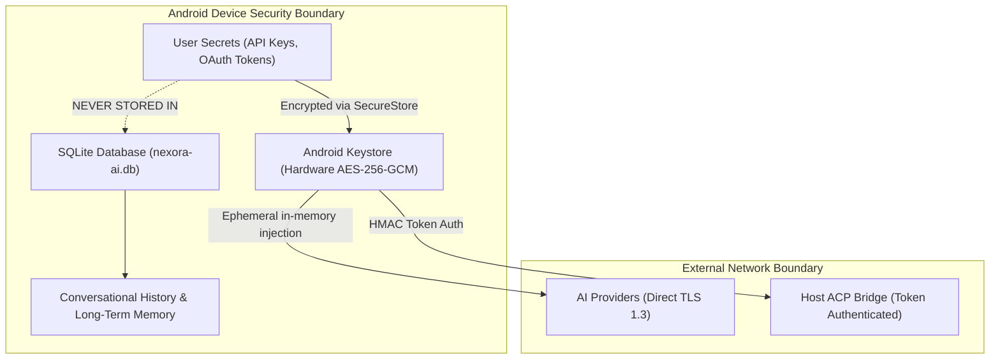

# Security & Privacy Audit — NEXORA AI

## 1. Threat Model & Security Posture

NEXORA AI adheres to a **Zero-Cloud-Trust, Local-First** security architecture. Because the application runs without a centralized backend server, user privacy risks associated with cloud data breaches, man-in-the-middle server logging, and centralized database leaks are completely eliminated.

---

## 2. Secrets Management & Storage Audit

- **Audit Finding**: In [src/core/services/secrets.ts](file:///storage/emulated/0/arya1/src/core/services/secrets.ts), all provider API keys (Gemini, OpenAI, Anthropic, xAI), OAuth access/refresh tokens, MCP server authorization headers, and host bridge tokens are stored strictly using **`expo-secure-store`**.
- **Hardware Encryption**: On Android, `expo-secure-store` encrypts data using AES-256-GCM with keys managed by the **Android KeyStore** provider, backed by hardware security modules (TEE / StrongBox) on supported hardware.
- **Zero Database Leakage**: An exhaustive audit of the 20 SQLite tables defined in [src/core/db/schema.ts](file:///storage/emulated/0/arya1/src/core/db/schema.ts) confirms that **no API keys, access tokens, client secrets, or passwords are saved in the database or logged to console output**.

---

## 3. Network & Transport Security

1. **TLS / HTTPS**: All cloud provider endpoints, remote catalog fetches, and APK downloads mandate strict TLS 1.2+ HTTPS.
2. **Cleartext Traffic Policy**: `usesCleartextTraffic: true` is enabled in `app.json` exclusively to allow local network HTTP/SSE communication with host desktop bridges (`http://192.168.x.x:7801`). All public domain traffic enforces HTTPS.
3. **Model Download Verification**: In [src/modules/on-device/catalog.ts](file:///storage/emulated/0/arya1/src/modules/on-device/catalog.ts) and [scripts/verify-model-catalog.mjs](file:///storage/emulated/0/arya1/scripts/verify-model-catalog.mjs), all downloadable on-device AI models require:
   - Pinned 64-character SHA-256 hash.
   - Exact byte count verification.
   - Any mismatched or tampered payload is rejected and deleted automatically before execution.

---

## 4. Privacy & Telemetry Findings

- **Zero Analytics**: The codebase contains **no Google Analytics, no Firebase Analytics, no Sentry, and no third-party tracking SDKs**.
- **Local Memory Privacy**: Long-term memories captured in the `memories` table remain strictly on the device. They are injected only into prompts dispatched to the user's explicitly selected AI provider.
- **SAF Scoped Storage**: The app does not request broad `MANAGE_EXTERNAL_STORAGE` permissions; it uses Android's Storage Access Framework (`saf-file-operations`) to restrict file access to folders explicitly chosen by the user.

---

## 5. Host Bridge Security

The ACP host bridge (`tools/acp-bridge/bridge.mjs`):
- Requires authentication on non-loopback addresses via a random 256-bit token (`bridge-token`) stored with `0600` POSIX permissions.
- Employs a 5-minute TTL on QR code pairing requests (`PAIRING_TTL_MS = 5 * 60 * 1000`).
- Restricts file upload sizes to 200 MB (`MAX_UPLOAD_BYTES = 200 * 1024 * 1024`).
