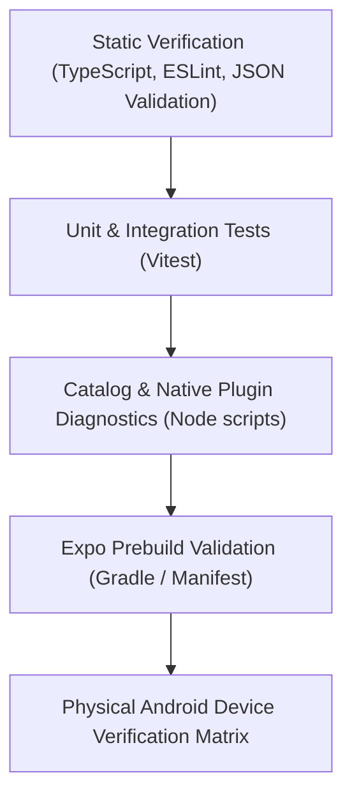

# Testing & QA Master Plan — NEXORA AI

## 1. Multi-Layer Testing Architecture



---

## 2. Automated Test Suites & Vitest

The repository includes a comprehensive Vitest test suite configured in [vitest.config.mts](file:///storage/emulated/0/arya1/vitest.config.mts):

| Subsystem | Test Files Count | Key Areas Covered |
| :--- | :--- | :--- |
| **Provider Auth & OAuth** | 6 test files | PKCE state validation, redirect URL formatting, token refresh |
| **Context & Token Budgeting**| 12 test files | Sliding window boundaries, heuristic compaction, token estimators |
| **Document Processing** | 18 test files | PDF section parsing, DOCX snapshots, XLSX cell extraction, PPTX |
| **Video & Media Preview** | 22 test files | Video asset timelines, audio mix scripts, headless render hosts |
| **Voice & Whisper** | 10 test files | PCM audio buffers, WAV headers, persistent model chunking |
| **Database Repositories** | 8 test files | SQLite CRUD operations, cascade deletions, migration versioning |
| **Tools & Agent Runtime** | 26 test files | Tool discovery, approval gating, built-in tool execution |
| **Native Config Plugins** | 2 test files | Manifest XML injection, receiver and service configuration |

---

## 3. Pre-Flight Diagnostics Pipeline

Before any build or commit is considered verified:

1. **JSON Syntax Integrity**:
   ```bash
   node -e "JSON.parse(require('fs').readFileSync('app.json', 'utf8')); JSON.parse(require('fs').readFileSync('package.json', 'utf8'));"
   ```
2. **Model Catalog Integrity Diagnostic**:
   ```bash
   node scripts/verify-model-catalog.mjs
   ```
   *Expected Output*: `Verified 17 downloadable model entries.`
3. **Type Checking**:
   ```bash
   pnpm exec tsc --noEmit
   ```
4. **Unit Test Execution**:
   ```bash
   pnpm test
   ```

---

## 4. Physical Android Device Verification Matrix

When the APK is assembled, QA verification must validate the following 12 critical test scenarios:

| # | Test Scenario | Execution Steps | Expected Outcome | Pass Criteria |
| :- | :--- | :--- | :--- | :--- |
| 1 | **Clean Launch** | Install APK and launch from app drawer | NEXORA AI splash screen displays, opens to empty chat | Zero crashes; DB initializes to v28 |
| 2 | **Cloud AI Streaming** | Enter Gemini/OpenAI API key; send prompt | Message streams in real-time; Markdown renders cleanly | Token stream throttles at 96ms |
| 3 | **Offline On-Device AI** | Download Gemma 2B; enable Airplane Mode; chat | Local NPU/CPU executes model without internet | 100% offline completion |
| 4 | **Voice Speech-to-Text** | Tap mic; speak sentence | Voice transcribes via system/Whisper into composer | Text populates input bar |
| 5 | **System Text Selection** | Highlight text in Chrome/browser; tap "NEXORA AI" | App opens directly to `/settings/prompts` with text | Text captured via `ProcessTextActivity` |
| 6 | **Share Sheet Target** | Share an image or link from Photos to NEXORA AI | App opens with media staged in composer | Handled via `share-target` module |
| 7 | **Background Agent** | Run a complex multi-step prompt; lock screen | Notification shows progress; CPU wake lock held | Task finishes while phone is asleep |
| 8 | **Exact Alarm Scheduler**| Create a schedule for +2 minutes; exit app | Alarm fires exactly on time; executes background run | Wakes device via `AlarmManager` |
| 9 | **Host Bridge Pairing** | Run `tools/acp-bridge/bridge.mjs`; scan QR code | Phone pairs within 5 seconds; shows green connected | LAN bridge status connected |
| 10 | **SAF File Access** | Select folder in Library; create document | File writes to phone internal storage | Android DocumentsContract succeeds |
| 11 | **Video Export** | Request animation export (`/video` mode) | Headless canvas renders and exports MP4 video | Video playable in gallery |
| 12 | **Reboot Persistence** | Reboot device | BootReceiver restores scheduled cron alarms | Schedules intact in SQLite |
