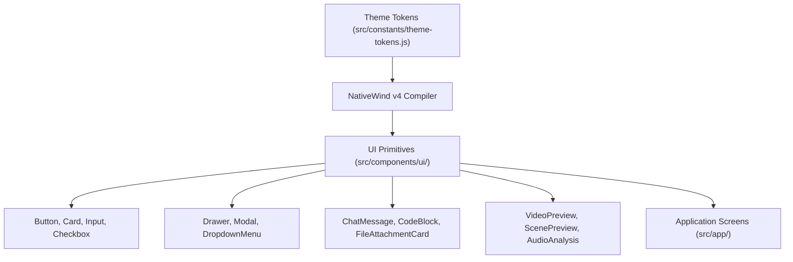

# UI/UX Transformation Plan — NEXORA AI

## 1. UI Architecture & Design System

NEXORA AI utilizes a modern, component-driven design system inspired by Radix UI and shadcn/ui, implemented natively on Android via **NativeWind v4** (Tailwind CSS) and **Reanimated v4**:

---

## 2. Screen-by-Screen Transformation Plan

### A. Main Chat Interface ([src/app/(root)/index.tsx](file:///storage/emulated/0/arya1/src/app/(root)/index.tsx))
- **Current State**: Features top bar with Sidebar trigger, New Chat button, Chat Info button; central virtualized message list with trace preview cards; bottom composer with voice mic, attachment sheet, tool mode pills (`/video`, `/docs`, `/general`), and dynamic composer tips.
- **NEXORA AI Transformation**:
  - Retain 100% of the conversational workflow, auto-scrolling, tool trace previews, and markdown rendering.
  - Update empty state subline in [src/components/chat/empty-state.tsx](file:///storage/emulated/0/arya1/src/components/chat/empty-state.tsx) to reflect NEXORA AI assistant identity.
  - Ensure composer tip links point to NEXORA AI documentation.

### B. App Sidebar ([src/components/ui/app-sidebar.tsx](file:///storage/emulated/0/arya1/src/components/ui/app-sidebar.tsx))
- **Current State**: Displays `"Mobile Agent"` in header; Library and Agents navigation buttons; pinned chats; recent chats; OpenCode sessions accordion; Settings button in footer.
- **NEXORA AI Transformation**:
  - Update Line 227 header text from `"Mobile Agent"` to **`"NEXORA AI"`**.
  - Retain all chat session management actions (new chat, rename, export JSON, pin/unpin, delete).

### C. Settings Hub ([src/app/(root)/settings/index.tsx](file:///storage/emulated/0/arya1/src/app/(root)/settings/index.tsx))
- **Current State**: Grouped card links for Providers, Harnesses, Integrations, Built-in Tools, MCP Servers, Skills, Plugins, Agents, Saved Prompts, Memory, Jobs, Background Agent, Voice Input, Notifications, Announcements, Current Model, Theme, Database, App Update.
- **NEXORA AI Transformation**:
  - Retain every setting row and drawer.
  - App Update row will seamlessly reflect NEXORA AI GitHub releases.
  - Background agent and battery optimization permission drawers remain fully functional.

### D. Library ([src/app/(root)/library.tsx](file:///storage/emulated/0/arya1/src/app/(root)/library.tsx))
- **Current State**: Searchable grid/list of workspace files, documents, and media with thumbnail rendering.
- **NEXORA AI Transformation**: Complete preservation of workspace file management and SAF import/export.

### E. Terminal ([src/app/(root)/terminal.tsx](file:///storage/emulated/0/arya1/src/app/(root)/terminal.tsx))
- **Current State**: Live Termux interactive console session.
- **NEXORA AI Transformation**: Preserved without modification.

---

## 3. Design Tokens & Styling Specifications

Design tokens are defined in [src/constants/theme-tokens.js](file:///storage/emulated/0/arya1/src/constants/theme-tokens.js):

| Token Category | Token Key | Value (Light) | Value (Dark) | Description |
| :--- | :--- | :--- | :--- | :--- |
| **Canvas** | `background` | `#F7F7F9` | `#141618` | App background surface |
| **Elements** | `backgroundElement` | `#F0F0F3` | `#212225` | Card and input background |
| **Selected** | `backgroundSelected` | `#E0E1E6` | `#2E3135` | Active drawer selection |
| **Typography** | `text` | `#000000` | `#FFFFFF` | Primary body and heading text |
| **Muted Text** | `textSecondary` | `#60646C` | `#B0B4BA` | Subtitles and timestamp labels |
| **Borders** | `border` | `#D4D7DE` | `#3A3F46` | Border and separator lines |
| **Danger** | `destructive` | `#DC2626` | `#EF4444` | Delete and cancel actions |
| **Accent** | `accent` | `#E0E1E6` | `#2E3135` | Subtle highlight elements |

### Typography:
- **Font Family**: `@expo-google-fonts/geist` (`Geist_400Regular`, `Geist_600SemiBold`).
- Monospace font uses Android native system monospace for code blocks and terminal logs.

---

## 4. Interaction Preservation Guarantee

All interactive states—including swipe gestures, keyboard avoidance (`react-native-keyboard-controller`), predictive back gesture handling, bottom sheet drag dismissals, and audio waveform animations—will be preserved identically in NEXORA AI.
